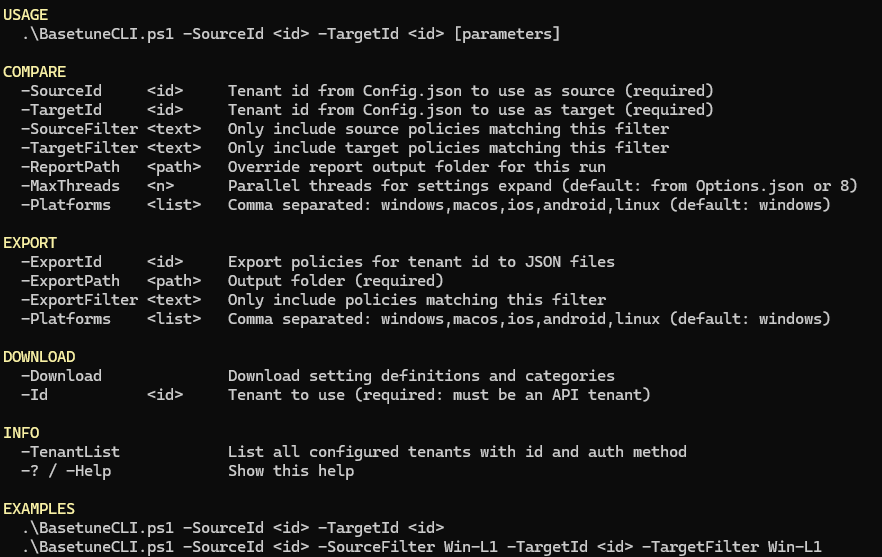

## What it does

Basetune is a PowerShell-based tool to compare **Intune Settings Catalog** and **Security Baseline** policies between online tenants (Microsoft Graph API) and exported baselines (JSON files).

Comparison capabilities:
- **Source vs. Target** — Each run compares one source against one target. Source and target can be any combination of online tenants and offline baselines.
- **Unlimited tenant configuration** — Configure as many tenants and baselines as you need, then pick which two to compare at runtime.
- **Platform aware** — Only policies for the selected platforms (Windows, macOS, iOS/iPadOS, Android, Linux) are loaded and compared.


<br>

<br>


## Requirements

- Windows with PowerShell 7+
- For an API tenant: a Microsoft Entra app registration with the **DeviceManagementConfiguration.Read.All** application permission for Microsoft Graph.
  > An administrator must grant tenant-wide admin consent for this permission.
- For a JSON tenant: a folder with exported policy files in JSON format.
  > Each file must contain `id`, `name`, `platforms` and a `settings` array. `templateReference` is optional. Files without a required field are skipped and listed in the log.


<br>

## Quick Start

1. Download the latest [Release](https://github.com/roweski/basetune/releases/latest) and extract it to a folder of your choice.
2. Start Basetune with Start-BasetuneUI.cmd or from PowerShell 7:
```
pwsh.exe .\BasetuneUI.ps1
```
3. Click Tenant Configuration (gear icon) to add an API tenant (app registration) or a JSON tenant (a folder with exported policies).
4. Select a source and a target tenant and click **Load** on both sides.
5. All loaded policies are selected by default. Click **Compare Policies** to run the comparison.
6. Click **View Report** to open the HTML report, or **View Details** to open Diff.csv.

<br>

## Resolve Display Names and Categories

Intune policies contain raw IDs instead of readable names. Basetune resolves them with lightweight definition files that keep only the properties it needs, so they load fast. 
Missing categories are retrieved from the Graph API during a compare when at least one API tenant is selected. 

> Basetune includes a `Definitions\settings.default.json` and `Definitions\categories.default.json` file which can become outdated over time. Refresh them with **Download** in the UI or `-Download` in the CLI (needs an API tenant). A download writes `settings.json` and `categories.json`, which are used instead of the `.default` files.

Additional categories are saved to `categories.json`. A setting without a definition is still compared, but shown with its raw ID.


<br>

## Report and Output


For each comparison, the report identifies one of four outcomes::

- **Match** — the setting is present in the target with the same value
- **Diff** — the setting is present in the target, but its value differs
- **Missing** — the setting is not present in the target
- **Extra** — the setting is present in the target but not in the source

On top of that, it detects cross-policy issues within the target tenant:

- **Duplicate** — the setting appears in multiple target policies with the same value
- **Conflict** — the setting appears in multiple target policies with different values

<br>

| File | Description |
|---|---|
| `Report.html` | Visual overview — one row per unique setting with aggregated status |
| `Diff.csv` | Full detail — one row per source setting × target policy match |
| `Summary.csv` | Per baseline policy: Total / Match / Missing / Diff counts + Compliance % |

<br>

## Comparison edge cases

Below are a number of non-trivial cases that the tool handles correctly.

### Implicit parent levels in the breadcrumb path

The setting path in the `Setting` column may contain parent levels that are **not** defined as categories in the categories JSON file. The tool reconstructs the full hierarchy, this means the path reflects the **logical** hierarchy as shown in the UI, not just the category tree from the JSON.

For example, `Choose how BitLocker-protected operating system drives can be recovered` is not a category in the JSON. Yet it appears as a parent segment in the path of its sub-setting.

### Nested sub-settings

Some settings contain additional configuration options that only become available when the parent setting is set to **Enabled**. Basetune combines these into a single readable output value: `Enabled: SelectedValue`

**Source setting:**

- *Choose how BitLocker-protected operating system drives can be recovered* → `Enabled`
  - Dropdown → `Do not allow 256-bit recovery key`

**Report output:**

| Setting | Source value |
|---|---|
| Administrative Templates > Windows Components > BitLocker Drive Encryption > Operating System Drives > Choose how BitLocker-protected operating system drives can be recovered | Enabled: Do not allow 256-bit recovery |


<br>

## CLI

Basetune includes a command-line interface for running comparisons and exports from a terminal or automation script.

<a href="docs/Cmd.png" target="_blank">
  
</a>

<br>
<br>


## Authentication

Basetune uses the **OAuth 2.0 client credentials flow** with a **client secret** or a **certificate**. Tokens are kept **in memory only** and renewed automatically.

- **Client secret:** stored encrypted (Windows DPAPI) in `Config.json`. It only works for the same Windows user on the same PC.
- **Certificate:** `Config.json` only holds the thumbprint. The certificate with private key must be in `Cert:\CurrentUser\My` or `Cert:\LocalMachine\My`.

## Secret storage

Client secrets for `ClientSecret` tenants are stored in `Config\Config.json` in **encrypted form** using the **Windows Data Protection API (DPAPI)**. Plaintext secrets never touch disk after the first save.

### How it works

- **Encryption scope:** `CurrentUser` — the secret can only be decrypted by the **same Windows user** on the **same machine** that encrypted it. Other users on the same box (including local admins) cannot decrypt it.
- **Storage format:** encrypted values in `Config.json` are prefixed with `DPAPI:` followed by a hex-encoded blob. Anything without that prefix is treated as plaintext.
- **Automatic migration:** if you place a plaintext secret in `Config.json`, Basetune detects it on first load, encrypts it with DPAPI, and rewrites `Config.json` in place. The plaintext value is replaced — no manual step needed.
- **In memory:** decrypted secrets exist briefly in memory only for the duration of the OAuth 2.0 token request, then drop out of scope. Tokens themselves are never persisted.

> Because DPAPI binds the encrypted secret to the **Windows user profile that encrypted it**, running the CLI under a different account requires a one-time setup step in that account's context.

<br>

## Offline JSON compatibility

Offline mode accepts Intune Settings Catalog and Security Baseline JSON files exported by any of the following tools:

| Source | How to export |
|---|---|
| **Basetune CLI** | Use `-ExportId <tenant id>` |
| **Basetune UI** | Click the export button. |
| **Intune portal** | Devices → Configuration → select policy → Export JSON |
| **[Open Intune Baseline](https://github.com/SkipToTheEndpoint/OpenIntuneBaseline)** | Download JSON files from GitHub |
| **[Micke-K IntuneManagement](https://github.com/Micke-K/IntuneManagement)** | Export Settings Catalog policies via the built-in export |

  > Each file must contain `id`, `name`, `platforms` and a `settings` array. `templateReference` is optional. 

<br>

## Error Handling, Throttling & Retries

The module features a robust, built-in error handling mechanism to ensure resilience during bulk operations and high-concurrency workloads.

When configuring **Parallel Threads** for settings expansion or policy evaluations, keep this behavior in mind:
* **Higher thread counts** will speed up the process initially.
* Excessive parallel requests increase the likelihood of triggering **HTTP 429 (Throttling)**.


---

## License

MIT — free to use, modify and distribute.

---

*Built for the Intune community.*
