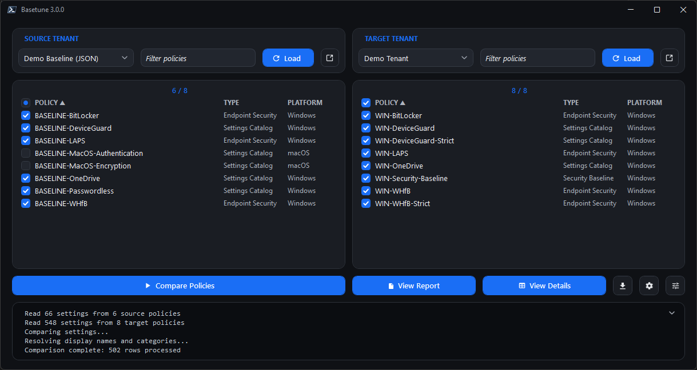
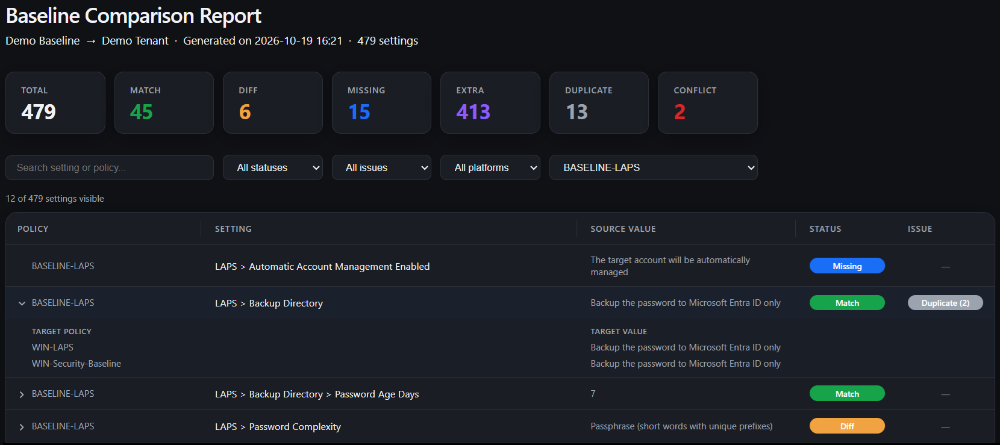
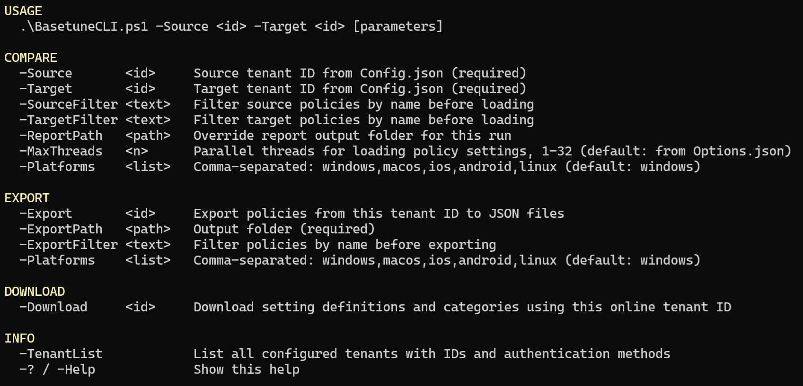

# Basetune


## What it does
Basetune is a PowerShell-based tool to compare Intune **Settings Catalog** and **Security Baseline** policies between online tenants via Microsoft Graph or offline baselines using JSON exports.



Comparison capabilities:

- **Live comparison** — Compare policies from online tenants via Microsoft Graph.
- **Offline comparison** — Compare policies from offline baselines using JSON exports, without an internet connection. Setting and category definitions are stored locally for future comparisons.
- **Platform-aware comparison** — Only policies for the selected platforms (Windows, macOS, iOS/iPadOS, Android, and Linux) are loaded and compared.

<br>

## Requirements

- Windows with PowerShell 7+
- For an online tenant: a Microsoft Entra app registration with the **DeviceManagementConfiguration.Read.All** application permission for Microsoft Graph.
  > An administrator must grant tenant-wide admin consent for this permission.
- For an offline baseline: a folder containing exported policy files in JSON format.
  > Each file must contain `id`, `name`, `platforms` and a `settings` array. `templateReference` is optional.

<br>

## Quick Start

1. Download the latest [Release](https://github.com/roweski/basetune/releases/latest) and extract it to a folder of your choice.
2. Start Basetune with Start-BasetuneUI.cmd or from PowerShell 7:
```
pwsh.exe .\BasetuneUI.ps1
```
3. Click Tenant Configuration (gear icon) to add an online tenant or an offline baseline.
4. Select a source and a target, then click **Load** on both sides.
5. All loaded policies are selected by default. Click **Compare Policies** to run the comparison.
6. Click **View Report** to open the HTML report, or **View Details** to open Diff.csv.

<br>

## Resolve Display Names and Categories

Intune policies contain raw IDs instead of readable names. Basetune resolves them using lightweight definition files that contain only the properties it needs, keeping them fast to load.

> Basetune includes `Definitions\settings.default.json` and `Definitions\categories.default.json`, which may become outdated over time. Click the Download button in the UI to create or refresh `Definitions\settings.json` and `Definitions\categories.json` for future comparisons (requires an online tenant).

A setting without a definition is still compared but shown with its raw ID. Missing categories are retrieved from Microsoft Graph during a comparison if an online tenant is selected. All categories are then saved to `Definitions\categories.json`.

<br>

## Report and Output

Each comparison generates the following files:

- **Report.html** — Interactive overview with one row per unique setting and an aggregated status.
- **Diff.csv** — Detailed results with one row per source setting and target policy match.
- **Summary.csv** — Compliance summary for each source policy.
- **Compare.log** — Log of compared policies, duplicate policy names or IDs, and skipped settings.

<br>

The HTML report is interactive and works offline as a standalone file in any browser.



<br>

The report identifies one of four outcomes for each comparison:

- **Match** — The setting is present in the target with the same value.
- **Diff** — The setting is present in the target but has a different value.
- **Missing** — The setting is not present in the target.
- **Extra** — The setting is present in the target but not in the source.

<br>

Basetune also detects cross-policy issues within the target:

- **Duplicate** — The setting appears in multiple target policies with the same value.
- **Conflict** — The setting appears in multiple target policies with different values.

<br>

## CLI

Basetune includes a command-line interface for running comparisons and exports from a terminal or automation script.



Examples:

```
.\BasetuneCLI.ps1 -TenantList
.\BasetuneCLI.ps1 -Source 1 -Target 2
.\BasetuneCLI.ps1 -Source 1 -SourceFilter Win -Target 2 -ReportPath D:\Reports
.\BasetuneCLI.ps1 -Export 1 -ExportPath C:\Export
.\BasetuneCLI.ps1 -Download 1
.\BasetuneCLI.ps1 -Help
```

> The client secret in Config.json can only be decrypted by the Windows user who saved it. To run the CLI under another account (for example, as a scheduled task), use a separate Basetune folder for that account and enter the client secret once in Tenant Configuration while signed in as that account.

<br>

## Comparison edge cases

Basetune handles the following cases to produce readable and consistent comparison results.

### Duplicates and unknown settings

Policies with **unresolved settings** or **unknown setting types** are listed in Compare.log.

Policies with the same name or ID are always compared separately, listed in Compare.log, and shown in the reports as follows:

| Case | Result |
|---|---|
| Same name, different ID | `Policy (<id>)` |
| Same name, same ID | `Policy (<id>)`, `Policy (<id>#2)` |
| Different name, same ID | `Policy A`, `Policy B` |
| Unique name, different ID | `Policy` |

> Duplicate IDs occur only in offline baselines, for example when a policy is renamed in the Intune portal and exported again to the same folder, or when a file is copied within the folder.

### Implicit parent levels in the Breadcrumb Path

The path in the `Setting` column may contain parent levels that are not defined as categories in the category definition files. Basetune reconstructs the full hierarchy so that the path reflects the logical hierarchy shown in the Intune portal, rather than only the category tree defined in the files.

For example, `Choose how BitLocker-protected operating system drives can be recovered` may appear as a parent segment in the path of a sub-setting, even though it is not defined as a category.

### Nested sub-settings

Some settings expose additional options only when the parent setting is set to `Enabled`. Basetune combines the parent and selected sub-setting value into a single readable output value.

**Setting:**

- *Choose how BitLocker-protected operating system drives can be recovered* → `Enabled`
  - Dropdown → `Allow 256-bit recovery key`

**Report output:**

| Setting | Value |
|---|---|
| Administrative Templates > Windows Components > BitLocker Drive Encryption > Operating System Drives > Choose how BitLocker-protected operating system drives can be recovered | Enabled: Allow 256-bit recovery key |


<br>

## Authentication

Basetune uses the **OAuth 2.0 client credentials flow** with either a **client secret** or a **certificate**. 

- **Client secret** — Stored encrypted with Windows DPAPI (CurrentUser scope) in `Config\Config.json`. Only the same Windows user on the same machine can decrypt it.
- **Certificate** — Only the certificate thumbprint is stored in `Config\Config.json`. The certificate, including its private key, must be in `Cert:\CurrentUser\My` or `Cert:\LocalMachine\My`.

When loading `Config\Config.json`, Basetune encrypts any plaintext client secrets using DPAPI and saves the updated configuration. Secrets are decrypted only when needed, either for a token request or to display the secret in Tenant Configuration, and Basetune never writes them to disk in plaintext. Access tokens are stored in memory only and are requested again when needed, never renewed in the background.

<br>

## Offline JSON compatibility

Offline mode accepts Intune Settings Catalog and Security Baseline JSON files exported by any of the following tools:

| Source | How to export |
|---|---|
| **Basetune UI** | Click the export button |
| **Basetune CLI** | Use `-Export <tenant id>` |
| **Intune portal** | Devices → Configuration → select policy → Export JSON |
| **[Open Intune Baseline](https://github.com/SkipToTheEndpoint/OpenIntuneBaseline)** | Download JSON files from GitHub |
| **[Micke-K IntuneManagement](https://github.com/Micke-K/IntuneManagement)** | Export Settings Catalog policies via the built-in export |

<br>

## Error Handling, Throttling & Retries

Graph requests are retried on throttling (HTTP 429), time-outs (HTTP 504) and network errors.

**Max Threads** defines how many policies are loaded from Microsoft Graph in parallel. Too many parallel requests can trigger throttling (HTTP 429). Set in Options or with -MaxThreads (1–32, default 8)


---

## License

MIT — free to use, modify and distribute.

---

*Built for the Intune community.*
